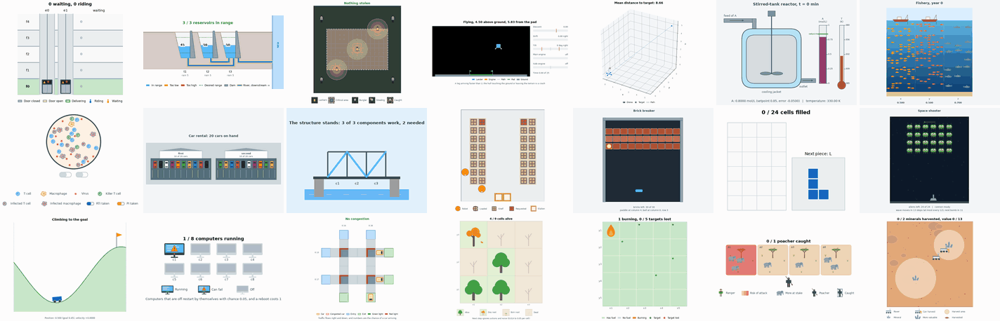

# pyRDDLGym


[](https://pypi.org/project/pyRDDLGym/)
[](https://pyrddlgym.readthedocs.io/en/latest/)


**Write a planning problem in a few lines of RDDL, get a Gym environment. The official parser, simulator and evaluation system for RDDL in Python.**



[Why pyRDDLGym?](#why-pyrddlgym) | [Installation](#installation) | [Quick start](#quick-start) | [Usage](#usage) | [Planners](#planners) | [Learning RDDL](#learning-rddl) | [Citing](#citing-pyrddlgym)

## Why pyRDDLGym?

- **Compact.** A few lines of RDDL describe a dynamic, stochastic control problem: compare [CartPole in RDDL](https://github.com/pyrddlgym-project/rddlrepository/blob/main/rddlrepository/archive/standalone/CartPole/Continuous/domain.rddl#L61) with [200 lines of Python in Gym](https://github.com/openai/gym/blob/master/gym/envs/classic_control/cartpole.py#L130).
- **Scalable.** Domains are relational templates, so an instance grows from one object to thousands without touching the domain, as in [Wildfire](https://ataitler.github.io/IPPC2023/pyrddlgym_rddl_tutorial.html) and [Reservoir Control](https://colab.research.google.com/drive/19O-vgPsEX7t32cqV0bABmAdRaSWSMa4g?usp=sharing).
- **Gym-compatible.** Every problem is a Gym environment, so it fits right into your existing workflow.
- **Visual.** Built-in and custom [visualizers](#visualization) and [movie recording](#recording-movies) make domains easy to debug and plans easy to understand, like this student project [visualizing JaxPlan plans](https://github.com/CowboyTime/CISC813-Project-USV-Nav/blob/main/CISC813%20Gifs/V2_5Moving_2.gif) in a [sailing domain](https://github.com/CowboyTime/CISC813-Project-USV-Nav/blob/main/Version2/USV_obstacle_nav_v2_Domain.rddl).
- **Analyzable.** Compile domains into [Dynamic Bayesian Networks](https://github.com/pyrddlgym-project/pyRDDLGym-symbolic?tab=readme-ov-file#visualizing-dbns-with-xadd) and [XADDs](https://github.com/pyrddlgym-project/pyRDDLGym-symbolic?tab=readme-ov-file#xadd-compilation-of-cpfs) to study causal dependencies and transition distributions.
- **Ready to plan.** Plug in [planners and RL agents](#planners) out of the box, in [Python](#installation) or in the browser with the [RDDL Playground on Colab](https://colab.research.google.com/drive/1XjPnlujsJPNUqhHK5EuWSVWQY2Pvxino?usp=sharing).

## Installation

Install the latest release with pip:

```shell
pip install pyRDDLGym
```

Or get the pre-release version from GitHub:

```shell
git clone https://github.com/pyRDDLGym-project/pyRDDLGym.git
```

pyRDDLGym comes without domains of its own: load your own RDDL files, or install [rddlrepository](https://github.com/pyrddlgym-project/rddlrepository) for a library of ready-made problems, including every IPPC problem:

```shell
pip install rddlrepository
```

> [!NOTE]
> Version 2.0 (February 2024) changed the API and is not backwards compatible with 1.4.4.
> If you need the old API, install it with ``pip install pyRDDLGym==1.4.4``, or from GitHub with ``pip install git+https://github.com/pyrddlgym-project/pyRDDLGym@version_1.4.4_stable``.

## Quick start

Create an environment, as in Gym, and evaluate a random policy on it:

```python
import pyRDDLGym
from pyRDDLGym.core.policy import RandomAgent

env = pyRDDLGym.make("CartPole_Continuous_gym", "0")
agent = RandomAgent(env)
stats = agent.evaluate(env, episodes=1, verbose=True, render=True)
```

For more, see the [gallery of example notebooks](https://pyrddlgym.readthedocs.io/en/latest/examples.html) and the [scripts](#example-scripts) packaged with pyRDDLGym.

## Usage

### Loading an environment

Load a problem from rddlrepository by name and instance (here instance ``0`` of CartPole):

```python
import pyRDDLGym
env = pyRDDLGym.make("CartPole_Continuous_gym", "0")
```

Or load your own domain and instance files:

```python
env = pyRDDLGym.make("/path/to/domain.rddl", "/path/to/instance.rddl")
```

Either way, ``env`` is a Gym environment with ``reset()`` and ``step()`` ready to use.
Extra settings go to ``make()`` as keywords, for example to check that every action is valid:

```python
env = pyRDDLGym.make("CartPole_Continuous_gym", "0", enforce_action_constraints=True)
```

### Interacting with an environment

A policy maps states to actions through ``sample_action(state)``. For example, a random policy:

```python
from pyRDDLGym.core.policy import RandomAgent
agent = RandomAgent(env)
```

Run it on the environment step by step:

```python
state, _ = env.reset()
for step in range(env.horizon):
    env.render()
    action = agent.sample_action(state)
    state, reward, terminated, truncated, _ = env.step(action)
    if terminated or truncated:
        break
env.close()
```

Or evaluate it in one line, which returns a dictionary of summary statistics (``"mean"``, ``"std"`` and others):

```python
stats = agent.evaluate(env, episodes=1, verbose=True, render=True)
```

> [!NOTE]
> States (in an MDP), observations (in a POMDP) and actions are ``dict`` objects keyed by the fluents defined in the RDDL description.
> A key is written ``pvar-name___o1__o2...``: the pvariable name, then 3 underscores, then its objects ``o1``, ``o2``... separated by 2 underscores.

### Visualization

pyRDDLGym has three built-in visualizers:

```python
env.set_visualizer("chart")
env.set_visualizer("heatmap")
env.set_visualizer("text")
```

To design your own, subclass ``pyRDDLGym.core.visualizer.viz.BaseViz``, override its ``render(state)`` method, and pass the class to the environment:

```python
viz_class = ...   # the class of your visualizer
env.set_visualizer(viz_class)
```

### Recording movies

To record an animated GIF or movie while interacting with an environment, pass a ``MovieGenerator`` to ``set_visualizer``:

```python
from pyRDDLGym.core.visualizer.movie import MovieGenerator
recorder = MovieGenerator("/path/where/to/save", "env_name")
env.set_visualizer(viz_class, movie_gen=recorder)

# then interact with the environment as usual
```

### Example scripts

pyRDDLGym comes with scripts that show its core features:

* [run_gym.py](https://github.com/pyrddlgym-project/pyRDDLGym/blob/main/pyRDDLGym/examples/run_gym.py) evaluates a random policy on an environment
* [run_gym2.py](https://github.com/pyrddlgym-project/pyRDDLGym/blob/main/pyRDDLGym/examples/run_gym2.py) does the same, with the interaction loop written out
* [run_ground.py](https://github.com/pyrddlgym-project/pyRDDLGym/blob/main/pyRDDLGym/examples/run_ground.py) grounds a domain and instance
* [run_intervals.py](https://github.com/pyrddlgym-project/pyRDDLGym/blob/main/pyRDDLGym/examples/run_intervals.py) bounds the value of a policy with interval arithmetic
* [run_server.py](https://github.com/pyrddlgym-project/pyRDDLGym/blob/main/pyRDDLGym/examples/run_server.py) sends and receives messages over TCP

### Parsing pitfalls

> [!WARNING]
> Two parsing rules are not documented in the RDDL language:
> 1. The minus sign needs spaces on both sides: ``x - 1`` subtracts, while ``x-1`` is read as a variable named ``x-1``.
> 2. An aggregation extends as far to the right as it can: ``sum_{?p : obj}[f(?p)] + 1`` adds 1 inside the sum. Write ``(sum_{?p : obj}[f(?p)]) + 1`` instead.

## Planners

pyRDDLGym environments work out of the box with these planners and learners:

* [JaxPlan](https://github.com/pyrddlgym-project/pyRDDLGym-jax): planning through automatic differentiation
* [GurobiPlan](https://github.com/pyrddlgym-project/pyRDDLGym-gurobi): planning through mixed discrete-continuous optimization
* [PROST](https://github.com/pyrddlgym-project/pyRDDLGym-prost): Monte Carlo tree search
* [Deep reinforcement learning](https://github.com/pyrddlgym-project/pyRDDLGym-rl): DQN, PPO and other algorithms from Stable Baselines and RLlib
* [Symbolic dynamic programming](https://github.com/pyrddlgym-project/pyRDDLGym-symbolic): exact symbolic regression-based planning and policy evaluation

## Learning RDDL

* [Web-based introduction](https://ataitler.github.io/IPPC2023/pyrddlgym_rddl_tutorial.html)
* [Full tutorial](https://pyrddlgym-project.github.io/AAAI24-lab)
* [Language specification](https://pyrddlgym.readthedocs.io/en/latest/rddl.html)
* [rddlrepository](https://github.com/pyRDDLGym-project/rddlrepository): a library of domains written in the latest RDDL syntax, good starting points for your own

## Related projects

* Other simulators: [rddlsim](https://github.com/ssanner/rddlsim), [rddlgym](https://github.com/thiagopbueno/rddlgym) and [pddlgym](https://github.com/tomsilver/pddlgym)
* The parser of pyRDDLGym is based on Thiago Pbueno's [pyrddl](https://github.com/thiagopbueno/pyrddl), used in [rddlgym](https://github.com/thiagopbueno/rddlgym)

## Citing pyRDDLGym

Our [paper](https://arxiv.org/abs/2211.05939) describes pyRDDLGym. If you find it useful, please cite:

```
@article{taitler2022pyrddlgym,
      title={pyRDDLGym: From RDDL to Gym Environments},
      author={Taitler, Ayal and Gimelfarb, Michael and Gopalakrishnan, Sriram and Mladenov, Martin and Liu, Xiaotian and Sanner, Scott},
      journal={arXiv preprint arXiv:2211.05939},
      year={2022}}
```

## License

This software is distributed under the MIT License.
